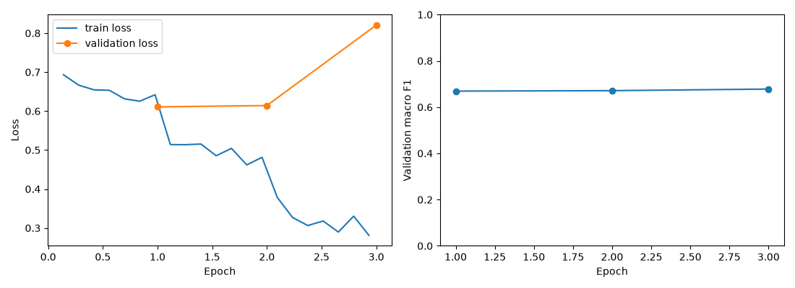

# 칭찬처럼 보이는데 사실은 비꼬는 말일까?
## BERT를 활용한 영어 SNS 문장의 아이러니 탐지

“Great, another meeting that could have been an email.”은 긍정적인 단어를 포함하지만,
전체적으로는 불필요한 회의에 대한 비꼼으로 읽을 수 있다.
이 프로젝트는 단순 감정 분석 대신 **표면적인 표현과 문맥의 불일치**를 다룬다.
연구 질문은 “BERT가 단어 빈도 기반 모델보다 아이러니를 잘 분류할 수 있는가?”이다.
아이러니는 비꼼보다 넓은 개념이며, 이 모델은 작성자의 실제 의도나 감정을 확정하지 않는다.

### 1. 사용한 모델과 데이터셋

선정한 `google-bert/bert-base-uncased`를 그대로 사용했다.
영어 BERT Base는 Transformer Encoder 12층으로 앞뒤 문맥을 반영하며,
uncased 토크나이저는 대소문자를 구분하지 않는다.
사전학습된 Encoder에 이진 분류층을 추가했다. 설명은 한국어, 모델 입력은 영어다.
[BERT 모델 카드](https://huggingface.co/google-bert/bert-base-uncased)

데이터는 `cardiffnlp/tweet_eval`의 `irony` 구성이다.
SemEval-2018 영어 트윗 아이러니 탐지 자료를 기반으로 하며
`0 = non_irony`, `1 = irony`로 구분한다.
[데이터 카드](https://huggingface.co/datasets/cardiffnlp/tweet_eval),
[공식 저장소](https://github.com/cardiffnlp/tweeteval)

| 분할 | 아이러니 아님 | 아이러니 | 합계 | 용도 |
|---|---:|---:|---:|---|
| 학습 | 1,417 | 1,445 | 2,862 | 가중치 학습 |
| 검증 | 499 | 456 | 955 | 최적 모델 선택 |
| 테스트 | 473 | 311 | 784 | 최종 평가 |

공식 분할을 유지했다. 테스트에는 아이러니가 아닌 문장이 더 많으므로 정확도와 F1을 함께 보고했다.
데이터 카드의 라이선스 표기는 unknown이며 재배포·상용 활용 전 원출처 조건 확인이 필요하다.

### 2. Tokenizer를 이용한 전처리

WordPiece 토크나이저로 문장을 토큰 번호로 바꾸었다. 위 예문의 실제 토큰은 다음과 같다.

```text
[CLS] great , another meeting that could have been an email . [SEP]
```

`input_ids`는 토큰 번호, `attention_mask`는 실제 토큰과 패딩의 구분,
`token_type_ids`는 문장 구분 정보다. 이번 단일 문장에서는 문장 구분 번호가 모두 0이다.
특수 토큰을 포함해 최대 128토큰까지만 입력하고 배치별 동적 패딩을 적용했다.
아이러니 단서가 될 수 있는 부정어·이모지·느낌표·해시태그는 별도로 제거하지 않았다.
다만 토크나이저 자체의 정규화나 미등록 기호 처리로 일부 정보가 손실될 수 있다.
학습 문장의 토큰 길이 중앙값은 **22**, 128토큰 초과 문장은 **1개, 약 0.035%**였다.

### 3. 사전학습 모델 Fine-tuning

사전학습된 Encoder와 새 분류층의 가중치를 모두 업데이트했다.
새 분류층은 무작위로 초기화되므로 학습 전 출력은 의미 있는 작업 결과로 간주하지 않았다.
Hugging Face `Trainer`로 Cross-Entropy loss를 계산하고 역전파했다.

| 설정 | 값 |
|---|---|
| Epoch | 3 |
| 학습률 | 2e-5 |
| 학습 배치 | 8 |
| 최대 입력 | 128토큰 |
| Weight decay | 0.01 |
| Warmup 비율 | 0.1 |
| Seed | 42 |
| 최적 모델 기준 | 검증 macro F1 |

매 epoch 검증하고 검증 macro F1이 가장 높은 체크포인트를 선택했다.
테스트 점수로 epoch를 고르지 않았다.
비교 모델은 단어·인접 두 단어를 특징으로 사용하는 TF-IDF + 로지스틱 회귀다.
비교 모델의 어휘와 분류기도 학습 데이터로만 학습했다.

### 4. 학습 과정 및 성능 평가

2026년 10월 11일 RTX 5050 Laptop GPU에서 실행했다.
BERT 학습에는 약 **83초**가 걸렸다. 설치·다운로드 시간은 제외한 값이다.
Python 3.12.7, PyTorch 2.11.0+cu128, Transformers 4.57.1, Datasets 4.4.1을 사용했다.

| Epoch | 검증 loss | 검증 Accuracy | 검증 macro F1 |
|---|---:|---:|---:|
| 1 | 0.6108 | 0.6702 | 0.6692 |
| 2 | 0.6143 | 0.6712 | 0.6712 |
| 3 | 0.8207 | 0.6785 | 0.6780 |

설정한 기준에 따라 3 epoch 모델이 선택됐다.
학습 loss는 감소했지만 검증 loss는 증가했다. 검증 F1이 조금 개선되는 동시에
틀린 예측의 확신이 커졌을 가능성이 있으며, 과적합과 확률 보정을 추가로 점검할 필요가 있다.



최종 테스트의 실제 실행 결과는 다음과 같다.

| 모델 | Accuracy | macro F1 | 아이러니 F1 | 아이러니 Precision | 아이러니 Recall |
|---|---:|---:|---:|---:|---:|
| TF-IDF + 로지스틱 회귀 | 0.6505 | 0.6424 | 0.5886 | 0.5521 | 0.6302 |
| BERT Fine-tuning | **0.6824** | **0.6801** | **0.6527** | **0.5764** | **0.7524** |

BERT의 정확도는 약 **3.19%p**, macro F1은 약 **0.0377** 높았다.
아이러니 recall이 높아져 실제 아이러니를 더 많이 찾아냈지만,
precision은 약 57.64%여서 오탐도 상당했다.
단일 seed의 비교이며 통계적 유의성이나 모든 기준 모델에 대한 우위를 증명하지 않는다.

| 실제 / 예측 | 아이러니 아님 | 아이러니 |
|---|---:|---:|
| 아이러니 아님 | 301 | 172 |
| 아이러니 | 77 | 234 |

784개 중 535개를 맞히고 249개를 틀렸다.
아이러니가 아닌 문장의 오탐 172개가 아이러니를 놓친 77개보다 많았다.

### 5. 새로운 문장을 직접 입력하여 예측

최적 모델을 저장한 뒤 다시 불러와 직접 만든 영어 문장 네 개를 예측했다.
노트북에는 사용자가 영어 문장을 직접 입력하는 셀도 있다.

| 새 문장 | 모델 예측 | 아이러니 출력 점수 |
|---|---|---:|
| Thank you for helping me finish the project. | 아이러니 | 0.9679 |
| Great, another meeting that could have been an email. | 아이러니 | 0.9591 |
| I love waiting two hours for a five minute appointment. | 아이러니 | 0.9871 |
| The train arrived on time today. | 아이러니 | 0.9542 |

두 번째·세 번째 문장은 비꼼으로 해석하기 자연스럽다.
그러나 일반적인 감사나 사실 전달로 읽을 수 있는 첫 번째·네 번째 문장도 아이러니로 예측했다.
**성공한 예시만 고르지 않고 실패도 기록했다.**
예문은 외부 정답이 확정된 평가 자료가 아니므로 본인의 해석과 비교한 사례로 보아야 한다.
softmax 출력 점수는 보정된 신뢰도가 아니며, 0.96이 “96% 정확도로 의도를 알아냈다”는 뜻은 아니다.

### 6. 문제점 및 개선 방법 분석

실제 테스트 오분류에서 다음 사례를 확인했다.

| 테스트 문장 또는 일부 발췌 | 데이터 정답 | 예측 | 관찰과 개선 가설 |
|---|---|---|---|
| I'm really excited for next semester | 아이러니 아님 | 아이러니 | 긍정 표현을 과하게 단서로 사용했을 가능성. 진짜 기대와 비꼼을 대비하는 자료를 추가한다. |
| Love it when my mans on a cleaning spree.. Saves me doing it | 아이러니 아님 | 아이러니 | 실제 이익에 대한 긍정도 오탐. love를 포함하는 정상 표현을 추가 평가한다. 원문에는 이모지가 있으며 위는 일부 발췌다. |
| #Sarcasm makes you mentally stronger. | 아이러니 아님 | 아이러니 | 관련 단어 언급과 실제 아이러니를 구분할 필요가 있다. 위는 원문의 일부 발췌다. |

원인 설명은 문장을 읽고 세운 **가설**이며 모델 내부의 인과적 원인을 확인한 것은 아니다.
첫 사례의 아이러니 점수는 약 0.9863으로 높은 점수로도 틀릴 수 있음을 보여준다.

| 문제점 | 개선 방법 |
|---|---|
| 긍정·감사 표현에 오탐 | 정상 표현과 아이러니를 대비하는 추가 주석 자료 확보 |
| 검증 loss 증가 | 검증 기반 early stopping·학습률 비교와 여러 seed 실험 |
| 높은 점수로 오답 | 검증 자료로 temperature scaling 등 확률 보정 |
| 앞 대화와 외부 상황 부재 | 앞선 발화·상황을 함께 입력하는 자료 구성 |
| 일반 영어와 SNS의 차이 | SNS 추가 사전학습 또는 도메인 모델과 별도 비교 |
| uncased로 강조 단서 손실 | cased 모델과 같은 조건으로 비교 |
| 영어 전용 | 한국어 BERT 계열과 한국어 아이러니 주석 자료로 재학습 |

테스트 오류를 보고 모델을 개선했다면 같은 테스트 점수만으로 성능을 반복 주장하지 않는다.
추가 개발에는 검증 자료를 사용하고 개선 결과는 별도 평가 자료로 확인한다.

### 프로젝트에서 배운 점

사전학습된 BERT에 분류층을 붙이고 토큰화·전체 Fine-tuning·검증 기반 선택·테스트 평가·저장 후 추론까지 수행했다.
이번 설정에서는 BERT가 기준 모델보다 높은 성능을 보였지만,
직접 만든 일반 문장에는 높은 점수로 오탐했다.
평균 성능과 개별 입력의 신뢰성을 함께 확인해야 한다는 점을 배웠다.

실행 코드는 `bert_irony_project.ipynb`, 성능은 `outputs/test_metrics.csv`,
학습 기록은 `outputs/training_history.csv`, 전체 오류는 `outputs/misclassified.csv`에 저장했다.
